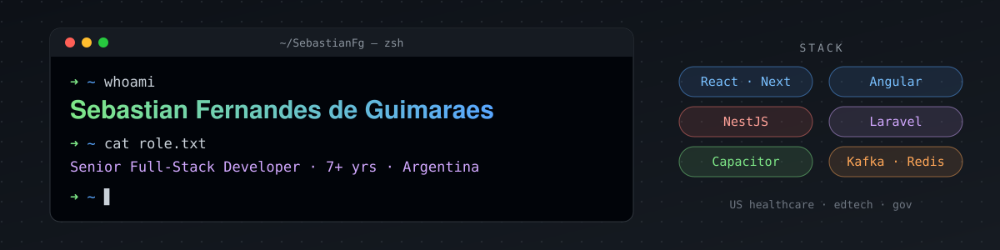

  

# Sebastian Fernandes de Guimaraes

### Senior Full-Stack Developer · web & mobile for US healthcare, edtech and the public sector

> Full-stack developer with **7+ years** building web and mobile apps for US companies (healthcare, education, digital marketing) and the public sector. I work across React, Angular, Node.js/NestJS and Laravel — from microservices and payment integrations to hybrid mobile apps in the stores — and I lead multidisciplinary teams. AI is part of my daily workflow (Claude, Spec-Driven Development). **HIPAA certified.** Based in Misiones, Argentina · remote with US teams.

## What I work on

- **Healthcare platforms** `Angular · Capacitor · React · HIPAA`
  Owner of the mobile apps at **Bridge Patient Portal** (US): **led the Cordova → Capacitor migration** and run the full build, deploy and release cycle on Google Play and the App Store, including new apps for new clients. Patient portals, clinical flows, billing, payments, medical forms and e-signature on HIPAA-protected data. Previously at **Medical Web Experts**, contributed to the front-end architecture of a product combining a web platform, a mobile app and a physical feeding pump.

- **Large-scale data migration** `NestJS · gRPC · Kafka · Redis`
  Designed and built a **bulk user-migration system for one of the largest education platforms in the US**: NestJS microservices talking over gRPC, Clever and ClassLink integrations, and a Kafka + Redis queue pipeline that **processes millions of users in a few hours**, covered by Jest tests.

- **Tech lead in the public sector** `Laravel · Node.js · Next.js · Docker · Jenkins`
  Team Lead at **Policía de Misiones** since 2019: drove the adoption of Laravel and Node.js microservices, built and lead a dev + QA + infra team, and set up **CI/CD with Docker and Jenkins**. Built the **first system in the province connecting three institutions that handle gender-violence cases** for immediate assistance, and led the data-processing platform for **national and provincial elections (2020–2021)**.

- **Payments** `MercadoPago · Pagos 360 · Macro Click · Helipagos`
  Integrated multiple payment gateways across public-sector systems, a driver's-license management and payment platform, and a social-media analytics SaaS (React + Laravel + Amazon Comprehend).

## Featured project

**[Medical Appointments System](https://github.com/SebastianFg/cmb-fe)** — full-stack app for a medical center, built for my degree at UGD.
[`cmb-fe`](https://github.com/SebastianFg/cmb-fe): React 19 + TypeScript + Vite, role-based routing, TanStack Query, Zod, Jest with an 80/85% coverage gate, E2E tests, Dockerized with Nginx.
[`cmb-be`](https://github.com/SebastianFg/cmb-be): Laravel 13 + PostgreSQL versioned REST API, Sanctum auth, Pest tests, fully Dockerized. Both repos are set up for AI agents (Claude skills, `AGENTS.md`, MCP).

## Toolbox

| | |
|---|---|
| **Frontend** | React, Next.js, Angular, Redux, RxJS, Tailwind CSS, Vite |
| **Backend** | Node.js, NestJS, Laravel, REST, gRPC, microservices |
| **Mobile** | Capacitor, Ionic, Cordova · Google Play & App Store releases |
| **Data & messaging** | PostgreSQL, MySQL, Redis, Kafka |
| **DevOps & testing** | Docker, Jenkins, CI/CD, GitLab, Jest, Swagger |
| **AI** | Claude, Spec-Driven Development, AI-assisted development |

## Connect

🇪🇸 Spanish (native) · 🇺🇸 English (intermediate) · Open to **Senior Full-Stack / Tech Lead** roles
